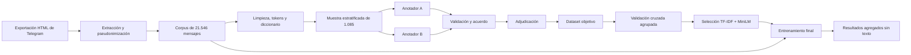

<!--
CARÁTULA

Reemplazar este bloque por la carátula solicitada por la materia:

- Universidad: Universidad Mayor de San Andrés
- Facultad: Ciencias Puras y Naturales
- Carrera: Informática
- Materia: Data Mining
- Título: Análisis de sentimientos y emociones en el grupo de Telegram
  de Temporada 2026 de la Carrera de Informática
- Docente: M.Sc. Menfy Morales Rios
- Integrantes:
  - Chavez Gutierrez Eddy Yojan
  - Copa Quispe Esther Sara
  - Rojas Condori Fidel Angel
  - Reyes Barja Carlos Eduardo
- Paralelo: A
- Lugar y fecha: La Paz, Bolivia — 28 de octubre de 2026

Al convertir este Markdown a Word o PDF se puede insertar un salto de página
después de la carátula.
-->

# Resumen ejecutivo

Este proyecto desarrolla un proceso reproducible de minería de texto para estudiar
la polaridad y las emociones expresadas en el grupo de Telegram de Temporada 2026
de la Carrera de Informática. Aunque el nombre actual del grupo menciona 2026, la
exportación conserva mensajes históricos desde el **16 de diciembre de 2022 hasta
el 12 de octubre de 2026**. El corpus final contiene **21.546 mensajes de texto**.

El trabajo no se limitó a aplicar un diccionario. Se construyó un dataset propio de
**1.085 mensajes**, etiquetado independientemente por dos anotadores y posteriormente
adjudicado. A partir de esta referencia humana se compararon cinco alternativas:

1. baseline de clase mayoritaria o ausencia de emoción;
2. diccionario contextual de reglas;
3. regresión logística con TF-IDF;
4. regresión logística con embeddings MiniLM;
5. regresión logística con la representación híbrida TF-IDF + MiniLM.

La evaluación se realizó con validación cruzada de cinco particiones y agrupación
por texto normalizado. Este diseño impide que dos mensajes idénticos aparezcan a la
vez en entrenamiento y prueba. El modelo híbrido obtuvo el mejor resultado entre
los modelos aprendidos: **macro-F1 de 0,393 para polaridad** y **0,375 para diez
emociones**. Después se entrenó con las 1.085 etiquetas finales y se aplicó al
corpus completo.

El resultado debe interpretarse como un análisis **exploratorio y agregado**. Las
predicciones no constituyen diagnósticos psicológicos ni deben utilizarse para
evaluar personas. Además, debido a que la muestra fue enriquecida con casos que
contenían señales emocionales, las proporciones del dataset manual no representan
directamente las proporciones del chat completo.

**Palabras clave:** minería de texto, análisis de sentimientos, emociones,
Telegram, TF-IDF, embeddings, MiniLM, clasificación multietiqueta.

# Introducción

Los grupos de mensajería instantánea se han convertido en un medio habitual de
coordinación académica. En ellos se publican consultas, anuncios, horarios,
recomendaciones, dificultades administrativas, agradecimientos y conversaciones
sociales. La revisión manual de miles de mensajes es lenta y difícil de repetir;
por ello, la minería de texto permite transformar el contenido no estructurado en
variables y resúmenes que puedan analizarse de manera sistemática.

El análisis de sentimientos busca reconocer la orientación afectiva general de un
texto. El análisis de emociones intenta identificar estados expresados de forma
más específica, por ejemplo alegría, preocupación, tristeza o gratitud. Esta tarea
es especialmente compleja en conversaciones reales porque aparecen abreviaciones,
faltas ortográficas, modismos locales, emojis, ironía, preguntas breves y mensajes
que dependen de intervenciones anteriores.

Una palabra aislada tampoco determina necesariamente una emoción. Por ejemplo,
una consulta puede contener la palabra “problema” sin expresar tristeza, y la frase
“no está mal” incluye una palabra negativa dentro de una construcción posiblemente
positiva. Debido a ello, el proyecto utiliza reglas interpretables como punto de
partida, pero contrasta sus resultados con anotación humana y con modelos que
representan el vocabulario y la semejanza semántica.

# Planteamiento del problema

El corpus contiene mensajes de distinta longitud, propósito y grado de expresividad.
Una gran cantidad corresponde a información o coordinación académica sin emoción
explícita, mientras que otras publicaciones pueden expresar varias emociones a la
vez. Un sistema basado únicamente en coincidencias de palabras puede:

- confundir una consulta neutral con preocupación;
- asignar polaridad a un anuncio puramente informativo;
- ignorar variaciones ortográficas y vocabulario local;
- perder el efecto de una negación;
- clasificar de forma incorrecta mensajes irónicos;
- forzar una sola emoción cuando coexisten varias.

La pregunta principal es:

> ¿Qué polaridades y emociones se expresan en el grupo de Telegram de Temporada de
> Informática, y qué tan bien pueden identificarse mediante reglas, TF-IDF y
> representaciones semánticas evaluadas contra un dataset humano propio?

Preguntas secundarias:

1. ¿Qué cobertura obtiene el diccionario original y cuánto mejora al adaptarlo al
   lenguaje del chat?
2. ¿Cuál es el nivel de acuerdo entre dos anotadores humanos?
3. ¿Los embeddings multilingües superan a una representación TF-IDF?
4. ¿La combinación de información léxica y semántica mejora el resultado?
5. ¿Qué clases son fáciles o difíciles de reconocer y por qué?

# Objetivos

## Objetivo general

Construir y evaluar un proceso reproducible de minería de texto y análisis de
sentimientos para identificar polaridades, emociones y patrones agregados en el
grupo de Telegram de Temporada de la Carrera de Informática.

## Objetivos específicos

1. Extraer mensajes desde la exportación HTML de Telegram.
2. Pseudonimizar a los participantes y separar datos privados de resultados
   publicables.
3. Limpiar, normalizar y tokenizar el contenido textual.
4. Construir un diccionario contextual de sentimientos y medir su cobertura.
5. Diseñar una muestra estratificada que incluya emociones poco frecuentes y
   mensajes sin evidencia léxica.
6. Etiquetar manualmente polaridad, emociones, intensidad, tema e ironía mediante
   dos anotadores independientes.
7. Medir el acuerdo entre anotadores y adjudicar los desacuerdos.
8. Comparar reglas, TF-IDF, embeddings MiniLM y una representación híbrida.
9. Evaluar los modelos sin fuga de textos duplicados mediante validación cruzada.
10. Aplicar el mejor modelo al corpus completo y presentar resultados agregados.
11. Documentar el código, los CSV, las limitaciones y los pasos de reproducción.

# Alcance, privacidad y ética

La unidad de análisis es cada mensaje textual. Se excluyeron eventos internos de
Telegram y archivos multimedia que no contaban con transcripción. Los nombres se
reemplazaron por códigos como `P001`, `P002`, etc. Esta medida es una
**pseudonimización**, no una anonimización absoluta: el contenido de un mensaje
podría conservar información identificable. Por ese motivo, los CSV que contienen
texto o participante deben permanecer privados.

Las salidas destinadas a presentación no incluyen texto ni códigos de participante.
Contienen solamente ID del mensaje, variables temporales, predicciones y valores de
confianza. El análisis describe señales lingüísticas agregadas; no permite concluir
cómo se siente realmente una persona ni efectuar diagnósticos psicológicos.

Principios aplicados:

- minimización de datos en las salidas;
- separación entre datos privados y resultados agregados;
- pseudonimización de participantes;
- ausencia de perfiles individuales;
- documentación de incertidumbre y limitaciones;
- uso académico y no disciplinario.

# Marco conceptual

## Minería de texto

La minería de texto convierte contenido no estructurado en representaciones
analizables. El proceso suele incluir extracción, limpieza, tokenización,
normalización, construcción de variables y aplicación de métodos descriptivos o
predictivos. En este proyecto se generó además una matriz documento-término de
**21.546 documentos y 10.421 términos**, con 117.268 celdas no nulas. Su dispersión
es 0,99948, algo esperado porque cada mensaje utiliza solo una pequeña fracción del
vocabulario total.

## Polaridad

La polaridad resume la orientación global del mensaje. Se utilizaron seis clases:

| Clase | Interpretación |
|---|---|
| `positiva` | Predomina una valoración o expresión favorable. |
| `negativa` | Predomina una valoración o expresión desfavorable. |
| `neutra` | Existe contenido emocional neutral o exploratorio. |
| `mixta` | Coexisten señales positivas y negativas. |
| `ambigua` | No es posible decidir con suficiente claridad. |
| `sin_sentimiento` | El mensaje es informativo o no contiene emoción explícita. |

`neutra` y `sin_sentimiento` no son sinónimos. La primera reconoce una señal
afectiva neutral, mientras que la segunda indica ausencia de evidencia emocional.

## Emociones y clasificación multietiqueta

Una tarea multiclase selecciona una sola clase. En cambio, una tarea multietiqueta
permite activar varias categorías simultáneamente. El proyecto conserva hasta dos
emociones humanas por mensaje y modela diez categorías con al menos veinte casos:

1. admiración;
2. alegría;
3. confusión;
4. curiosidad;
5. decepción;
6. enojo;
7. esperanza;
8. gratitud;
9. preocupación;
10. tristeza.

El requisito de trabajar con ocho o más emociones queda cubierto con diez clases.
Las categorías amor, tranquilidad, sorpresa, cansancio y vergüenza existen en el
libro de códigos, pero no alcanzaron el soporte mínimo para un aprendizaje y una
evaluación razonablemente estables.

## Diccionario contextual

Un diccionario relaciona palabras, raíces, expresiones y emojis con emociones y
polaridades. Su principal ventaja es la interpretabilidad: cada predicción puede
rastrearse hasta una evidencia. Su principal limitación es que la coincidencia no
comprende completamente el contexto.

Se partió de quince categorías del documento proporcionado por la materia y se
añadieron variantes ortográficas, expresiones frecuentes del chat, emoticonos y
emojis. La ampliación se documentó y se mantuvo separada de la anotación humana
para evitar que las sugerencias automáticas sesgaran a los anotadores.

## TF-IDF

TF-IDF pondera un término según dos factores:

- **TF:** frecuencia del término dentro del documento;
- **IDF:** rareza del término en el conjunto de documentos.

De forma simplificada:

<div class="formula">TF-IDF(t,d) = TF(t,d) × log(N / DF(t))</div>

En el proyecto se utilizaron unigramas y bigramas, `min_df=2`, un máximo de 30.000
características y escalamiento sublineal de la frecuencia. TF-IDF es útil para
capturar vocabulario local, pero dos frases semánticamente parecidas pueden quedar
lejos si no comparten palabras.

## Embeddings MiniLM

Un embedding representa cada mensaje mediante un vector denso. Se utilizó
`sentence-transformers/paraphrase-multilingual-MiniLM-L12-v2`, preparado para
representar semejanza semántica en múltiples idiomas. Los vectores fueron
normalizados y el modelo preentrenado permaneció congelado. Sobre ellos se entrenó
una regresión logística, una decisión apropiada para un dataset de tamaño limitado.

Los embeddings no son un diccionario creado desde cero por el proyecto: son una
representación semántica preentrenada. El componente propio del trabajo está en el
dataset humano, el diccionario contextual, la evaluación, la selección de clases y
el entrenamiento de los clasificadores finales.

## Modelo híbrido

La representación híbrida concatena ambas fuentes:

<div class="formula">X<sub>híbrido</sub> = [X<sub>TF-IDF</sub> | X<sub>MiniLM</sub>]</div>

TF-IDF conserva palabras y expresiones propias del entorno universitario; MiniLM
aporta información semántica. Una regresión logística balanceada aprende a combinar
las dos representaciones.

## Métricas

### Kappa de Cohen

Mide acuerdo entre anotadores descontando el acuerdo esperado por azar:

<div class="formula">κ = (p<sub>o</sub> − p<sub>e</sub>) / (1 − p<sub>e</sub>)</div>

donde $p_o$ es el acuerdo observado y $p_e$ el esperado. Kappa debe interpretarse
junto con las distribuciones de clase; puede ser bajo cuando una categoría domina,
aunque el acuerdo porcentual sea alto.

### Precisión, recall y F1

<div class="formula">Precisión = VP / (VP + FP) &nbsp;&nbsp;·&nbsp;&nbsp; Recall = VP / (VP + FN)</div>

<div class="formula">F1 = 2 × (Precisión × Recall) / (Precisión + Recall)</div>

- **Macro-F1:** calcula F1 por clase y luego promedia con igual peso. Es la métrica
  principal porque no permite que una clase frecuente oculte el mal resultado de
  las clases minoritarias.
- **Micro-F1:** reúne todas las decisiones antes de calcular F1; da más peso a las
  categorías frecuentes.
- **Exactitud:** proporción de ejemplos completamente correctos.
- **Balanced accuracy:** promedio del recall de las clases.
- **Hamming loss:** fracción de decisiones binarias de emoción incorrectas; cuanto
  menor, mejor.

# Datos utilizados

## Resumen

| Elemento | Resultado |
|---|---:|
| Mensajes del corpus | 21.546 |
| Periodo | 16/12/2022–12/10/2026 |
| Mensajes etiquetados | 1.085 |
| Textos únicos normalizados en la muestra | 1.008 |
| Filas duplicadas adicionales agrupadas | 77 |
| Documentos de la matriz documento-término | 21.546 |
| Términos de la matriz documento-término | 10.421 |
| Emociones modeladas | 10 |
| Particiones de validación cruzada | 5 |

## Distribución de la muestra por gestión

| Gestión | Mensajes etiquetados |
|---:|---:|
| 2022 | 185 |
| 2023 | 227 |
| 2024 | 224 |
| 2025 | 227 |
| 2026 | 222 |
| **Total** | **1.085** |

La muestra está aproximadamente balanceada por gestión, pero fue enriquecida por
señales emocionales y por mensajes sin evidencia. Por ello sirve para entrenar y
comparar clasificadores, pero no para estimar directamente la prevalencia real de
emociones en las 21.546 publicaciones.

# Metodología

El flujo toma como referencia las fases de CRISP-DM: comprensión del problema,
comprensión de datos, preparación, modelado, evaluación y presentación.



## Extracción y pseudonimización

Los archivos `messages.html`, `messages2.html`, etc. se localizaron y ordenaron
automáticamente. Con `rvest` y `xml2` se extrajeron fecha, autor y texto. Se
eliminaron eventos de servicio, filas sin fecha válida y contenido no textual.
Luego se crearon variables de gestión, mes, hora y día de la semana.

Los nombres reales se sustituyeron por códigos secuenciales. El identificador
`message_id` permite relacionar archivos sin usar el texto como clave.

## Preprocesamiento

Se conservaron dos representaciones:

- texto original, únicamente en archivos privados, para trazabilidad y anotación;
- texto normalizado, para minería y comparación de duplicados.

Las operaciones principales fueron:

1. normalización Unicode;
2. conversión de URL a un marcador `<URL>` en Python;
3. conversión a minúsculas cuando corresponde;
4. compactación de espacios;
5. codificación previa de emojis y emoticonos para que no desaparezcan;
6. tokenización;
7. eliminación de stopwords, conservando negaciones importantes como “no”,
   “nunca” y “sin”;
8. stemming en español para los análisis descriptivos;
9. construcción de unigramas, bigramas y matriz documento-término.

## Diccionario y cobertura

El diccionario original clasificó 2.034 de 21.546 mensajes. La ampliación contextual
clasificó 5.299.

| Versión | Clasificados | Sin coincidencia | Cobertura |
|---|---:|---:|---:|
| Diccionario original | 2.034 | 19.512 | 9,4% |
| Diccionario ampliado | 5.299 | 16.247 | 24,6% |

La cobertura creció 15,2 puntos porcentuales, pero **cobertura no significa
exactitud**. Solo indica en cuántos mensajes hubo alguna coincidencia. La calidad se
evaluó después contra las etiquetas humanas.

## Muestreo

Se aplicó una semilla fija (`20261024`) para garantizar reproducibilidad. La muestra
combinó:

- selección por gestión y emoción sugerida por las reglas;
- refuerzo de mensajes sin evidencia, para representar contenido informativo o
  difícil de clasificar;
- eliminación de duplicados por `message_id`.

Esta estrategia mejora la presencia de clases poco frecuentes. Su costo es que la
distribución del dataset etiquetado deja de ser una estimación poblacional directa.

## Anotación manual

Los dos anotadores trabajaron independientemente sobre 1.085 filas. No debían
consultar `referencia_reglas_no_usar_al_etiquetar.csv`, porque ver una predicción
previa puede producir sesgo de anclaje.

Por mensaje se registraron:

- presencia de sentimiento;
- polaridad;
- emoción principal y segunda emoción opcional;
- intensidad de 0 a 3;
- tema;
- ironía;
- confianza de la anotación;
- observaciones opcionales.

## Validación y adjudicación

Los scripts comprobaron etiquetas permitidas, campos obligatorios, IDs duplicados y
coherencia estructural. Las decisiones originales de A y B no se sobrescribieron.
Los desacuerdos relevantes se copiaron a una plantilla separada y fueron resueltos
mediante adjudicación.

La etiqueta objetivo se construyó así:

1. si A y B coincidían, se conservaba el acuerdo;
2. si no coincidían, se utilizaba la decisión adjudicada;
3. la fuente de cada objetivo quedaba registrada.

Resultado:

| Fuente | Polaridad | Emociones |
|---|---:|---:|
| Acuerdo A/B | 638 | 481 |
| Adjudicación | 447 | 604 |
| **Total** | **1.085** | **1.085** |

## Modelado

Se compararon cinco alternativas bajo las mismas filas de prueba:

| Modelo | Función |
|---|---|
| Baseline | Establece el mínimo que un modelo debe superar. |
| Diccionario | Reglas interpretables sin aprendizaje supervisado. |
| TF-IDF + logística | Aprende vocabulario y bigramas del dominio. |
| MiniLM + logística | Aprende sobre vectores semánticos preentrenados. |
| TF-IDF + MiniLM + logística | Combina vocabulario local y semántica. |

La regresión logística utilizó `class_weight="balanced"`, `solver="lbfgs"`,
`max_iter=3000` y semilla `20261026`. Para emociones se entrenó un clasificador
binario por categoría mediante `OneVsRestClassifier`.

## Validación cruzada sin fuga de información

Se normalizó cada texto y se calculó un hash SHA-256. Las 1.085 filas se redujeron a
1.008 grupos de texto único; había 77 repeticiones adicionales. Se aplicó
`StratifiedGroupKFold` con cinco folds:

- la estratificación intenta conservar la distribución de polaridad;
- la agrupación mantiene juntas todas las copias del mismo texto;
- cada fila se evalúa exactamente una vez fuera de muestra;
- los resultados de las cinco partes forman las predicciones OOF (*out of fold*).

Sin la agrupación, un texto repetido podría aparecer en entrenamiento y prueba,
inflando artificialmente las métricas.

# Bitácora de limpieza y transformación

Esta sección incorpora la metodología solicitada en `bitacora.pdf` y la aplica al
proyecto real. La bitácora funciona como un *audit trail*: registra qué se revisó,
qué decisión se tomó, por qué se tomó y qué script permite reproducirla.

## Correspondencia con la metodología solicitada

### 1. Auditoría y perfilado inicial

Antes de modificar los datos se inspeccionaron tipos, fechas, cardinalidades,
ausencias y tamaños. El perfil final del corpus es:

| Control | Resultado |
|---|---:|
| Archivos HTML procesados | 29 |
| Mensajes válidos | 21.546 |
| IDs únicos | 21.546 |
| Participantes pseudonimizados | 1.594 |
| Texto faltante | 0 |
| Fecha faltante | 0 |
| Participante faltante | 0 |
| Longitud mínima / mediana / máxima | 1 / 41 / 2.646 caracteres |
| Mensajes con URL | 1.433 |
| Emojis contabilizados | 5.175 |

### 2. Normalización de estructura y formatos

Las fechas se convirtieron a ISO-8601 (`YYYY-MM-DD`), la hora a entero de 0 a 23 y
las variables lógicas a valores consistentes. Para modelado se normalizó Unicode,
se reemplazaron URL por `<URL>` y se compactaron espacios. Las etiquetas se pasaron
a minúsculas, sin tildes y con guion bajo como separador.

No se sobrescribió el texto original: la versión original se conserva para auditoría
y la normalizada se utiliza para minería. Esta separación permite revisar una
transformación sin perder la fuente.

### 3. Gestión de duplicados

No se encontraron `message_id` repetidos en el corpus final. Sí existen mensajes
textualmente idénticos, algo normal en un chat por respuestas breves, enlaces o
publicaciones repetidas. En el corpus hay 17.457 textos normalizados únicos y 4.089
filas adicionales repetidas.

No se eliminaron todas esas filas porque cada una representa una publicación real
en un momento determinado. Para evaluación predictiva se agruparon por hash: en la
muestra manual hubo 1.008 grupos únicos y 77 repeticiones adicionales. Todas las
copias de un texto permanecieron en el mismo fold.

### 4. Tratamiento de valores faltantes

No se imputó texto ni se inventaron etiquetas. Los eventos sin texto analizable se
excluyeron durante la extracción. En la anotación, un objetivo vacío se trató como
error y el pipeline se detuvo hasta que fuera completado o adjudicado. Después de
la consolidación quedaron 1.085 polaridades y 1.085 conjuntos emocionales válidos.

Esta decisión es preferible a imputar con moda o media: una emoción faltante no es
una medición numérica ausente, sino una decisión humana que debe revisarse.

### 5. Detección y tratamiento de valores atípicos

Se revisaron longitudes, cantidad de palabras, signos, enlaces y emojis. El mensaje
más largo tiene 2.646 caracteres. No se aplicó eliminación automática mediante IQR
o Z-score, porque un mensaje largo puede ser un anuncio académico válido y no un
error. Los valores extremos se conservaron salvo que incumplieran una regla de
validez, como fecha ilegible, ausencia total de texto o evento de servicio.

### 6. Consistencia y reglas de negocio

Se validaron categorías permitidas y relaciones lógicas. Algunos ejemplos son:

- `intensidad` solo puede ser 0, 1, 2 o 3;
- si no existe sentimiento, la emoción principal debe ser `sin_sentimiento`;
- polaridad y emociones objetivo no pueden quedar vacías;
- `message_id` debe ser único;
- las emociones deben pertenecer al libro de códigos;
- los desacuerdos A/B no pueden consolidarse sin adjudicación;
- al menos ocho emociones deben alcanzar el soporte mínimo de modelado;
- un texto duplicado no puede cruzar entrenamiento y prueba;
- las predicciones publicables no deben contener texto ni participante.

## Registro de auditoría aplicado

| ID | Fecha | Responsable | Dataset o etapa | Problema o control | Acción realizada | Criterio y resultado | Filas afectadas o verificadas | Código |
|---:|---|---|---|---|---|---|---:|---|
| 1 | 21/10/2026 | Equipo | Exportación Telegram | Archivos fragmentados | Lectura y orden automático de `messages*.html` | Se procesaron 29 archivos en orden | 29 archivos | `R/funciones.R` |
| 2 | 21/10/2026 | Equipo | Corpus | Eventos no analizables y fechas | Extracción de mensajes válidos y conversión de fechas | Corpus final de 21.546 mensajes entre 2022-12-16 y 2026-10-12 | 21.546 verificadas | `01_ejecutar_analisis.R` |
| 3 | 21/10/2026 | Equipo | Autor | Dato personal | Sustitución por códigos `P001`, `P002`, etc. | Minimización de identificación directa | 21.546 mensajes; 1.594 códigos | `extraer_mensajes()` |
| 4 | 21/10/2026 | Equipo | Texto | Formatos heterogéneos | Minúsculas, Unicode, espacios, URL, emojis y normalización | Se conserva también el texto original | 21.546 verificadas | `normalizar_texto()` |
| 5 | 21/10/2026 | Equipo | Corpus | Posibles duplicados de ID | Comprobación de unicidad | 0 IDs duplicados | 21.546 verificadas | `01_ejecutar_analisis.R` |
| 6 | 21/10/2026 | Equipo | Texto | Publicaciones repetidas | Conservación en corpus y agrupación en validación | 17.457 textos únicos; 4.089 repeticiones adicionales | 21.546 verificadas | `text_group()` |
| 7 | 21/10/2026 | Equipo | Diccionario | Baja cobertura inicial | Ampliación con variantes, expresiones, emojis y emoticonos | Cobertura de 9,4% a 24,6% | 3.265 mensajes adicionales cubiertos | `crear_diccionario()` |
| 8 | 21/10/2026 | Equipo | Corpus | Necesidad de referencia humana | Muestreo estratificado por gestión y señal, más refuerzo sin evidencia | Semilla fija `20261024` | 1.085 seleccionadas | `02_generar_dataset_manual.R` |
| 9 | 26/10/2026 | Equipo/Codex | Etiquetado B | Tres valores mecánicamente inválidos en una etapa intermedia | Normalización documentada sin inventar decisiones semánticas | Correcciones trazables | 3 celdas | `06_corregir_etiquetado_b.R` |
| 10 | 26/10/2026 | Anotadores A/B | Etiquetado | Campos incompletos o inválidos | Validación de categorías, IDs y obligatoriedad | A y B: 1.085 filas válidas, 0 errores finales | 2.170 anotaciones | `03_validar_dataset_manual.R` |
| 11 | 26/10/2026 | Equipo/Codex | Consenso | Desacuerdo humano | Adjudicación separada sin sobrescribir A ni B | 447 polaridades y 604 conjuntos emocionales adjudicados | 1.051 decisiones objetivo | `07_consolidar_adjudicaciones.R` |
| 12 | 26/10/2026 | Equipo/Codex | Modelado | Riesgo de fuga por repetición | Cinco folds estratificados y agrupados por SHA-256 | 1.008 grupos; 77 repeticiones controladas | 1.085 evaluadas OOF | `09_validacion_cruzada.py` |
| 13 | 26/10/2026 | Equipo/Codex | Selección | Comparación desigual de clases | Selección por macro-F1 entre modelos aprendidos | Ganó TF-IDF + MiniLM | 5 modelos comparados | `09_validacion_cruzada.py` |
| 14 | 26/10/2026 | Equipo/Codex | Corpus completo | Salida con posible información privada | Exclusión de texto y participante | 21.546 predicciones protegidas | 21.546 clasificadas | `10_clasificar_corpus.py` |

## Trazabilidad automática de ejecuciones

`resultados/datos/bitacora_ejecuciones.csv` conserva fecha y hora, número de HTML,
mensajes analizados, periodo y huellas MD5 de las entradas. Las huellas permiten
comprobar si se volvió a ejecutar el análisis con exactamente los mismos archivos.

La bitácora humana se mantiene en `BITACORA.md`; la bitácora automática registra
ejecuciones del pipeline, y esta tabla reúne ambas fuentes en el formato solicitado
por la guía de limpieza.

# Implementación: código esencial

Esta sección resume los fragmentos que mejor justifican las decisiones técnicas.
El código completo se conserva en `R/` y `scripts/`.

## Normalización de etiquetas

```r
normalizar_etiqueta <- function(x) {
  x |>
    dplyr::coalesce("") |>
    stringi::stri_trans_general("Latin-ASCII") |>
    stringr::str_to_lower() |>
    stringr::str_squish() |>
    stringr::str_replace_all("[ /-]+", "_")
}
```

Esto evita que valores equivalentes como `Alegría`, `alegria` o ` ALEGRIA ` se
interpreten como categorías diferentes.

## Creación reproducible de la muestra

```r
set.seed(20261024)

estratificada <- universo |>
  dplyr::group_by(gestion, estrato) |>
  dplyr::group_modify(
    ~ dplyr::slice_sample(.x, n = min(n_por_estrato, nrow(.x)))
  ) |>
  dplyr::ungroup()
```

La semilla permite obtener la misma selección al repetir el procedimiento sobre el
mismo corpus.

## Construcción del objetivo adjudicado

```r
final <- datos |>
  dplyr::left_join(adjudicadas, by = "message_id") |>
  dplyr::mutate(
    polaridad_objetivo = dplyr::case_when(
      acuerdo_polaridad ~ polaridad_consenso,
      doble_anotacion ~ polaridad_adjudicada,
      TRUE ~ polaridad_manual
    ),
    fuente_polaridad = dplyr::case_when(
      acuerdo_polaridad ~ "acuerdo_ab",
      doble_anotacion ~ "adjudicado",
      TRUE ~ "solo_a"
    )
  )
```

La procedencia de la etiqueta queda explícita y puede auditarse.

## Agrupación de textos duplicados

```python
def text_group(value: object) -> str:
    normalized = normalize_text(value).lower()
    return hashlib.sha256(normalized.encode("utf-8")).hexdigest()

splitter = StratifiedGroupKFold(
    n_splits=5,
    shuffle=True,
    random_state=20261026,
)

splits = splitter.split(
    data,
    data["polaridad_objetivo"],
    groups=data["text_group"],
)
```

El hash no se utiliza como característica del modelo; únicamente identifica textos
iguales para separarlos correctamente.

## TF-IDF y representación híbrida

```python
vectorizer = TfidfVectorizer(
    ngram_range=(1, 2),
    min_df=2,
    max_features=30000,
    sublinear_tf=True,
)

tfidf_train = vectorizer.fit_transform(text_train)
tfidf_test = vectorizer.transform(text_test)

hybrid_train = sparse.hstack(
    [tfidf_train, sparse.csr_matrix(embedding_train)],
    format="csr",
)
hybrid_test = sparse.hstack(
    [tfidf_test, sparse.csr_matrix(embedding_test)],
    format="csr",
)
```

El vectorizador se ajusta solo con el fold de entrenamiento. Ajustarlo antes de
dividir los datos permitiría que el vocabulario de prueba influyera en el proceso.

## Clasificador balanceado

```python
def logistic():
    return LogisticRegression(
        max_iter=3000,
        class_weight="balanced",
        solver="lbfgs",
        random_state=20261026,
    )

emotion_classifier = OneVsRestClassifier(logistic(), n_jobs=-1)
emotion_classifier.fit(x_train, y_emotions_train)
```

`class_weight="balanced"` aumenta el peso relativo de las clases escasas. No crea
datos nuevos ni garantiza que las clases muy pequeñas sean aprendidas.

## Predicción multietiqueta

```python
emotion_probability = emotion_classifier.predict_proba(x_corpus)
emotion_prediction = (emotion_probability >= 0.5).astype(int)

emotion_labels = [
    ";".join(labels) if labels else "sin_sentimiento"
    for labels in mlb.inverse_transform(emotion_prediction)
]
```

Cada emoción obtiene una probabilidad independiente. El umbral global es 0,5. Si
ninguna emoción lo supera, la salida se registra como `sin_sentimiento`.

## Protección de la salida final

```python
predictions = pd.DataFrame({
    "message_id": corpus["message_id"],
    "gestion": corpus["gestion"],
    "fecha": corpus["fecha"],
    "hora": corpus["hora"],
    "polaridad_predicha": polarity_prediction,
    "confianza_polaridad": polarity_probability.max(axis=1),
    "emociones_predichas": emotion_labels,
    "confianza_emocion_max": emotion_probability.max(axis=1),
})
```

No se exportan `texto` ni `participante` en `predicciones_corpus.csv`.

# Guía de los archivos CSV

## Regla de lectura

Cada fila representa un mensaje, una clase o una combinación de agrupación según el
archivo. El separador entre columnas es coma. Cuando una celda contiene varias
emociones, se usa punto y coma, por ejemplo `preocupacion;tristeza`.

Los siguientes ejemplos son **sintéticos**: explican la estructura sin copiar
mensajes reales del grupo. Para facilitar la lectura se muestran únicamente las
columnas relevantes; los archivos reales pueden contener columnas descriptivas
adicionales.

## `corpus_anonimizado.csv`

Contiene el corpus completo pseudonimizado. Debe mantenerse privado porque conserva
texto y código de participante.

```csv
message_id,gestion,fecha,hora,participante,texto
message_demo_001,2026,2026-01-10,9,P001,"¿Alguien sabe el horario de inscripción?"
message_demo_002,2026,2026-01-10,10,P002,"Muchas gracias por la ayuda"
```

- `message_id`: identificador estable;
- `gestion`, `fecha`, `hora`: variables temporales;
- `participante`: seudónimo;
- `texto`: contenido original privado.

## `etiquetado_anotador_a.csv` y `etiquetado_anotador_b.csv`

Son las hojas independientes de anotación. Las columnas descriptivas no deben
alterarse; los anotadores completan las variables manuales.

```csv
message_id,texto,tiene_sentimiento,polaridad_manual,sentimiento_1,sentimiento_2,intensidad,tema,ironia,confianza_anotacion,responsable
message_demo_002,"Muchas gracias por la ayuda",si,positiva,gratitud,alegria,2,conversacion_social,no,alta,ANOTADOR_A
```

Interpretación: el anotador considera que existe sentimiento positivo, selecciona
gratitud como emoción principal, alegría como secundaria y asigna intensidad media.

## `referencia_reglas_no_usar_al_etiquetar.csv`

Guarda la salida del diccionario para compararla posteriormente con las decisiones
humanas. No debe mostrarse durante la anotación.

```csv
message_id,polaridad_regla,motivo_no_clasificado,emociones_regla,evidencias_regla,tipos_regla
message_demo_002,positiva,clasificado,gratitud,"muchas gracias",termino_exacto
```

Este archivo permite responder **por qué** se activó una regla.

## `dataset_consenso_umsa.csv`

Reúne A y B sin destruir sus decisiones. Sus campos indican si hubo doble anotación,
si coincidieron y cuál es el estado del consenso.

```csv
message_id,polaridad_manual,polaridad_b,acuerdo_polaridad,sentimientos_a,sentimientos_b,acuerdo_sentimientos,estado_consenso
message_demo_002,positiva,positiva,TRUE,gratitud;alegria,gratitud,FALSE,desacuerdo_ab
```

En el ejemplo hay acuerdo en polaridad, pero desacuerdo en el conjunto exacto de
emociones. Por ello solo la parte emocional necesita adjudicación.

## `desacuerdos_modelado.csv`

Es la plantilla donde se resuelven diferencias que afectan al modelo.

```csv
message_id,polaridad_a,polaridad_b,sentimientos_a,sentimientos_b,polaridad_adjudicada,sentimiento_1_adjudicado,sentimiento_2_adjudicado,intensidad_adjudicada,tema_adjudicado,ironia_adjudicada,observaciones_adjudicacion
message_demo_002,positiva,positiva,alegria;gratitud,gratitud,positiva,gratitud,alegria,2,conversacion_social,no,"Revisión final: Codex"
```

La adjudicación no significa escoger automáticamente A o B: requiere revisar el
mensaje y aplicar el libro de códigos.

## `dataset_modelado_umsa.csv`

Es la referencia final para entrenamiento y evaluación. Conserva los campos
anteriores y añade objetivos y procedencia.

```csv
message_id,polaridad_objetivo,sentimientos_objetivo,fuente_polaridad,fuente_sentimientos,apto_test_alta_confianza
message_demo_002,positiva,alegria;gratitud,acuerdo_ab,adjudicado,TRUE
```

Las columnas clave para Python son:

- `texto`: entrada del modelo, únicamente en el entorno privado;
- `polaridad_objetivo`: clase multiclase;
- `sentimientos_objetivo`: conjunto multietiqueta;
- `polaridad_regla` y `emociones_regla`: baseline del diccionario.

## `control_calidad.csv`

Contiene una sola fila con totales, errores y métricas de acuerdo.

```csv
filas_totales,completas_anotador_a,errores_a,completas_anotador_b,errores_b,kappa_polaridad,kappa_sentimiento
1085,1085,0,1085,0,0.418452,0.432436
```

## `comparacion_modelos.csv`

Cada fila es una combinación de tarea y modelo evaluada sobre predicciones OOF.

```csv
task,model,n_test,accuracy,balanced_accuracy,macro_f1,micro_f1,hamming_loss
polaridad,hibrido_tfidf_minilm,1085,0.529954,0.401263,0.393032,0.529954,
emociones_multietiqueta,hibrido_tfidf_minilm,1085,0.444240,,0.375453,0.382315,0.087558
```

Las celdas vacías son métricas no aplicables, no errores. Por ejemplo, Hamming loss
se usa en la tarea multietiqueta, no en la clasificación única de polaridad.

## `metricas_por_fold.csv`, `resumen_folds.csv` y `metricas_por_clase.csv`

- `metricas_por_fold.csv`: desempeño de cada modelo en cada una de las cinco partes;
- `resumen_folds.csv`: promedio y desviación estándar entre folds;
- `metricas_por_clase.csv`: precisión, recall, F1 y soporte de cada clase.

Estos archivos permiten demostrar que no se reportó únicamente el mejor número.

## `predicciones_corpus.csv`

Contiene las salidas finales sin texto ni participante.

```csv
message_id,gestion,fecha,hora,es_muestra_manual,polaridad_predicha,confianza_polaridad,emociones_predichas,confianza_emocion_max
message_demo_002,2026,2026-01-10,10,TRUE,positiva,0.81,alegria;gratitud,0.76
```

`confianza_polaridad` es la mayor probabilidad entre las seis polaridades.
`confianza_emocion_max` es la probabilidad emocional más alta, aunque puede haber
varias emociones activadas.

# Dashboard interactivo

El siguiente panel forma parte de esta misma página HTML. No consulta servidores ni
expone mensajes: utiliza únicamente los resúmenes agregados generados por el
pipeline. Los botones permiten cambiar entre polaridad, emociones y comparación de
modelos. En polaridad también se puede filtrar por gestión.

<div class="dashboard" id="dashboard-proyecto">
  <div class="dashboard-kpis">
    <article class="kpi"><span>Corpus</span><strong>21.546</strong><small>mensajes</small></article>
    <article class="kpi"><span>Referencia</span><strong>1.085</strong><small>doble anotación</small></article>
    <article class="kpi"><span>Emociones</span><strong>10</strong><small>clases modeladas</small></article>
    <article class="kpi"><span>Mejor modelo</span><strong>Híbrido</strong><small>TF-IDF + MiniLM</small></article>
  </div>

  <div class="dashboard-toolbar" role="group" aria-label="Vista del dashboard">
    <button class="db-button active" type="button" data-db-view="polaridad">Polaridad</button>
    <button class="db-button" type="button" data-db-view="emociones">Emociones</button>
    <button class="db-button" type="button" data-db-view="modelos">Modelos</button>
    <label class="db-filter" for="db-year">Gestión
      <select id="db-year">
        <option value="total">Todo el corpus</option>
        <option value="2022">2022</option>
        <option value="2023">2023</option>
        <option value="2024">2024</option>
        <option value="2025">2025</option>
        <option value="2026">2026</option>
      </select>
    </label>
  </div>

  <div class="dashboard-panel" aria-live="polite">
    <div>
      <p class="eyebrow" id="db-eyebrow">Distribución estimada</p>
      <h3 id="db-title">Polaridad predicha — todo el corpus</h3>
      <p id="db-description">Seleccione una gestión para comparar la distribución.</p>
    </div>
    <div class="db-bars" id="db-bars"></div>
    <div class="db-table-wrap">
      <table class="db-table">
        <thead><tr><th>Categoría</th><th id="db-value-heading">Mensajes</th><th>Porcentaje</th></tr></thead>
        <tbody id="db-table-body"></tbody>
      </table>
    </div>
    <p class="dashboard-note" id="db-note">Las cifras son predicciones agregadas, no diagnósticos individuales.</p>
  </div>
</div>

<script>
(() => {
  const dashboard = document.getElementById('dashboard-proyecto');
  if (!dashboard) return;

  const polarity = {
    total: [
      ['Sin sentimiento', 8974], ['Neutra', 5055], ['Negativa', 3694],
      ['Positiva', 2378], ['Ambigua', 1030], ['Mixta', 415]
    ],
    2022: [['Sin sentimiento',603],['Negativa',215],['Neutra',189],['Positiva',145],['Ambigua',42],['Mixta',16]],
    2023: [['Sin sentimiento',1646],['Neutra',772],['Negativa',668],['Positiva',415],['Ambigua',189],['Mixta',65]],
    2024: [['Sin sentimiento',2422],['Neutra',1501],['Negativa',984],['Positiva',633],['Ambigua',290],['Mixta',112]],
    2025: [['Sin sentimiento',2727],['Neutra',1649],['Negativa',1265],['Positiva',776],['Ambigua',355],['Mixta',138]],
    2026: [['Sin sentimiento',1576],['Neutra',944],['Negativa',562],['Positiva',409],['Ambigua',154],['Mixta',84]]
  };
  const emotions = [
    ['Sin sentimiento',8919],['Curiosidad',5558],['Preocupación',2280],
    ['Tristeza',1783],['Confusión',1531],['Decepción',1309],
    ['Esperanza',879],['Gratitud',731],['Alegría',694],
    ['Admiración',513],['Enojo',467]
  ];
  const models = [
    ['Baseline',0.099,0.000],['Diccionario',0.354,0.333],
    ['TF-IDF',0.305,0.312],['MiniLM',0.369,0.336],
    ['TF-IDF + MiniLM',0.393,0.375]
  ];
  const colors = ['#38bdf8','#22c55e','#fb7185','#fbbf24','#a78bfa','#94a3b8','#2dd4bf','#f472b6','#60a5fa','#c084fc','#f97316'];
  const bars = dashboard.querySelector('#db-bars');
  const body = dashboard.querySelector('#db-table-body');
  const title = dashboard.querySelector('#db-title');
  const description = dashboard.querySelector('#db-description');
  const note = dashboard.querySelector('#db-note');
  const heading = dashboard.querySelector('#db-value-heading');
  const year = dashboard.querySelector('#db-year');
  let view = 'polaridad';

  const integer = new Intl.NumberFormat('es-BO');
  const decimal = new Intl.NumberFormat('es-BO', {minimumFractionDigits: 1, maximumFractionDigits: 1});

  function renderDistribution(rows, total, label) {
    bars.innerHTML = '';
    body.innerHTML = '';
    const maximum = Math.max(...rows.map(row => row[1]));
    rows.forEach((row, index) => {
      const percent = row[1] / total * 100;
      const wrapper = document.createElement('div');
      wrapper.className = 'db-bar-row';
      wrapper.innerHTML = `<div class="db-bar-label"><span>${row[0]}</span><strong>${decimal.format(percent)}%</strong></div>
        <div class="db-track"><span style="width:${row[1] / maximum * 100}%;background:${colors[index % colors.length]}"></span></div>`;
      bars.appendChild(wrapper);
      const tr = document.createElement('tr');
      tr.innerHTML = `<td>${row[0]}</td><td>${integer.format(row[1])}</td><td>${decimal.format(percent)}%</td>`;
      body.appendChild(tr);
    });
    heading.textContent = 'Mensajes';
    title.textContent = label;
  }

  function renderModels() {
    bars.innerHTML = '';
    body.innerHTML = '';
    models.forEach((row, index) => {
      const wrapper = document.createElement('div');
      wrapper.className = 'db-model-row';
      wrapper.innerHTML = `<strong>${row[0]}</strong>
        <div class="db-model-pair"><span class="db-model-label">Polaridad ${row[1].toFixed(3)}</span><div class="db-track"><span style="width:${row[1] * 100}%;background:#38bdf8"></span></div></div>
        <div class="db-model-pair"><span class="db-model-label">Emociones ${row[2].toFixed(3)}</span><div class="db-track"><span style="width:${row[2] * 100}%;background:#2dd4bf"></span></div></div>`;
      bars.appendChild(wrapper);
      const tr = document.createElement('tr');
      tr.innerHTML = `<td>${row[0]}</td><td>${row[1].toFixed(3)}</td><td>${row[2].toFixed(3)}</td>`;
      body.appendChild(tr);
    });
    title.textContent = 'Macro-F1 fuera de muestra';
    description.textContent = 'Comparación sobre las 1.085 predicciones OOF. Un valor mayor es mejor.';
    heading.textContent = 'Polaridad';
    dashboard.querySelector('.db-table thead th:last-child').textContent = 'Emociones';
    note.textContent = 'El híbrido fue seleccionado por el mayor macro-F1 en ambas tareas.';
  }

  function render() {
    dashboard.querySelectorAll('.db-button').forEach(button => {
      button.classList.toggle('active', button.dataset.dbView === view);
    });
    year.closest('.db-filter').hidden = view !== 'polaridad';
    dashboard.querySelector('.db-table thead th:last-child').textContent = 'Porcentaje';

    if (view === 'polaridad') {
      const selected = year.value;
      const rows = polarity[selected];
      const total = rows.reduce((sum, row) => sum + row[1], 0);
      renderDistribution(rows, total, selected === 'total' ? 'Polaridad predicha — todo el corpus' : `Polaridad predicha — gestión ${selected}`);
      description.textContent = 'Distribución multiclase: cada mensaje recibe una sola polaridad.';
      note.textContent = 'Las cifras son predicciones agregadas, no diagnósticos individuales.';
    } else if (view === 'emociones') {
      renderDistribution(emotions, 21546, 'Emociones predichas — todo el corpus');
      description.textContent = 'Una publicación puede activar más de una emoción.';
      note.textContent = 'Los porcentajes pueden sumar más de 100% porque la tarea es multietiqueta.';
    } else {
      renderModels();
    }
  }

  dashboard.querySelectorAll('.db-button').forEach(button => {
    button.addEventListener('click', () => { view = button.dataset.dbView; render(); });
  });
  year.addEventListener('change', render);
  render();
})();
</script>

# Resultados

## Calidad de la anotación

Los dos archivos quedaron completos y sin errores estructurales.

| Indicador | Resultado |
|---|---:|
| Filas totales | 1.085 |
| Filas completas A | 1.085 |
| Filas completas B | 1.085 |
| Errores A/B | 0 / 0 |
| Duplicados A/B | 0 / 0 |
| Kappa de polaridad | 0,418 |
| Kappa de emoción principal | 0,432 |
| Jaccard de conjuntos emocionales | 0,523 |
| Acuerdo exacto de emociones | 0,443 |

Detalle por variable:

| Variable | Acuerdo observado | Kappa |
|---|---:|---:|
| Presencia de sentimiento | 70,7% | 0,446 |
| Polaridad | 58,8% | 0,418 |
| Emoción principal | 57,4% | 0,432 |
| Intensidad | 55,6% | 0,295 |
| Tema | 41,6% | 0,324 |
| Ironía | 94,7% | 0,220 |
| Confianza del anotador | 45,7% | -0,016 |

El acuerdo de polaridad y emoción es moderado. No se debe ocultar este resultado:
demuestra que el problema tiene ambigüedad real. El caso de ironía ilustra por qué
se reportan acuerdo y kappa juntos: casi todos los mensajes fueron marcados como no
irónicos, por lo que existe alto acuerdo bruto pero menor información más allá del
azar. La confianza es una autoevaluación subjetiva y no se utilizó como objetivo.

## Distribución del dataset adjudicado

| Polaridad | Mensajes | Porcentaje |
|---|---:|---:|
| Sin sentimiento | 458 | 42,2% |
| Negativa | 251 | 23,1% |
| Positiva | 155 | 14,3% |
| Neutra | 142 | 13,1% |
| Ambigua | 53 | 4,9% |
| Mixta | 26 | 2,4% |
| **Total** | **1.085** | **100%** |

Las emociones seleccionadas para modelado presentan el siguiente soporte:

| Emoción | Casos | Emoción | Casos |
|---|---:|---|---:|
| Curiosidad | 143 | Preocupación | 108 |
| Decepción | 60 | Confusión | 52 |
| Esperanza | 51 | Gratitud | 43 |
| Tristeza | 29 | Alegría | 28 |
| Admiración | 24 | Enojo | 24 |

En la referencia completa también existen emociones con menos de veinte casos, pero
no se incluyeron en el benchmark final porque sus métricas serían muy inestables.

## Comparación de modelos

### Polaridad

| Modelo | Exactitud | Balanced accuracy | Macro-F1 |
|---|---:|---:|---:|
| Baseline mayoritario | 0,422 | 0,167 | 0,099 |
| Diccionario | **0,540** | 0,376 | 0,354 |
| TF-IDF | 0,399 | 0,319 | 0,305 |
| MiniLM | 0,471 | 0,382 | 0,369 |
| **TF-IDF + MiniLM** | 0,530 | **0,401** | **0,393** |

### Emociones multietiqueta

| Modelo | Exactitud de conjunto | Macro-F1 | Micro-F1 | Hamming loss |
|---|---:|---:|---:|---:|
| Baseline sin emoción | **0,492** | 0,000 | 0,000 | **0,052** |
| Diccionario | 0,478 | 0,333 | 0,323 | 0,071 |
| TF-IDF | 0,386 | 0,312 | 0,325 | 0,091 |
| MiniLM | 0,291 | 0,336 | 0,340 | 0,133 |
| **TF-IDF + MiniLM** | 0,444 | **0,375** | **0,382** | 0,088 |


### Interpretación

El modelo híbrido se seleccionó mediante macro-F1, no mediante exactitud. En
polaridad, el diccionario obtiene una exactitud ligeramente mayor, pero el híbrido
equilibra mejor el reconocimiento de las seis clases. En emociones, el baseline
parece tener buena exactitud y bajo Hamming loss porque predice siempre “ninguna
emoción”. Su macro-F1 es cero: nunca encuentra una emoción real. Este resultado
demuestra que una única métrica puede ser engañosa en datos desbalanceados.

MiniLM supera a TF-IDF en polaridad, lo cual aporta evidencia de que la representación
semántica ayuda. La combinación vuelve a mejorar porque conserva simultáneamente
semántica general y vocabulario local.

El promedio entre folds del híbrido fue:

| Tarea | Macro-F1 promedio | Desviación estándar |
|---|---:|---:|
| Polaridad | 0,391 | 0,026 |
| Emociones | 0,365 | 0,059 |

La variación mayor en emociones se relaciona con su menor soporte y con la
dificultad de mantener exactamente la misma distribución multietiqueta en cada fold.

## Matriz de confusión de polaridad


Métricas por clase del modelo híbrido:

| Polaridad | Soporte | Precisión | Recall | F1 |
|---|---:|---:|---:|---:|
| Ambigua | 53 | 0,172 | 0,189 | 0,180 |
| Mixta | 26 | 0,000 | 0,000 | 0,000 |
| Negativa | 251 | 0,497 | 0,586 | 0,537 |
| Neutra | 142 | 0,372 | 0,500 | 0,426 |
| Positiva | 155 | 0,595 | 0,568 | 0,581 |
| Sin sentimiento | 458 | 0,719 | 0,566 | 0,633 |

La clase mixta no fue reconocida fuera de muestra. Solo tenía 26 ejemplos y requiere
detectar simultáneamente señales de signo contrario. Ambigua también es difícil por
definición. Las mejores clases fueron sin sentimiento, positiva y negativa.

## Desempeño por emoción


| Emoción | Soporte | Precisión | Recall | F1 |
|---|---:|---:|---:|---:|
| Gratitud | 43 | 0,878 | 0,837 | **0,857** |
| Admiración | 24 | 0,516 | 0,667 | 0,582 |
| Curiosidad | 143 | 0,434 | 0,643 | 0,518 |
| Preocupación | 108 | 0,314 | 0,546 | 0,399 |
| Decepción | 60 | 0,246 | 0,517 | 0,333 |
| Alegría | 28 | 0,225 | 0,571 | 0,323 |
| Tristeza | 29 | 0,148 | 0,586 | 0,236 |
| Esperanza | 51 | 0,167 | 0,216 | 0,188 |
| Enojo | 24 | 0,154 | 0,167 | 0,160 |
| Confusión | 52 | 0,120 | 0,231 | 0,158 |

Gratitud posee expresiones relativamente distintivas. Confusión, enojo, esperanza
y tristeza presentan menor precisión o recall porque comparten vocabulario con
consultas, problemas académicos y otras emociones. El soporte por sí solo no explica
todo: admiración tiene pocos casos, pero señales lingüísticas más reconocibles.

## Clasificación del corpus completo

Una vez seleccionado el híbrido, se volvió a entrenar con las 1.085 filas y se
clasificaron 21.546 mensajes. Estas cifras no son etiquetas humanas; son
estimaciones del modelo final.

### Polaridad predicha

| Polaridad | Mensajes | Porcentaje |
|---|---:|---:|
| Sin sentimiento | 8.974 | 41,65% |
| Neutra | 5.055 | 23,46% |
| Negativa | 3.694 | 17,14% |
| Positiva | 2.378 | 11,04% |
| Ambigua | 1.030 | 4,78% |
| Mixta | 415 | 1,93% |
| **Total** | **21.546** | **100%** |


La mayoría de los mensajes es informativa o neutral, lo cual es coherente con un
grupo académico orientado a consultas y coordinación. No debe afirmarse que “el
grupo es negativo”: la predicción negativa corresponde al 17,14% y además está
sujeta al error observado en validación.

### Emociones predichas

| Emoción | Mensajes | Porcentaje de mensajes |
|---|---:|---:|
| Sin sentimiento | 8.919 | 41,40% |
| Curiosidad | 5.558 | 25,80% |
| Preocupación | 2.280 | 10,58% |
| Tristeza | 1.783 | 8,28% |
| Confusión | 1.531 | 7,11% |
| Decepción | 1.309 | 6,08% |
| Esperanza | 879 | 4,08% |
| Gratitud | 731 | 3,39% |
| Alegría | 694 | 3,22% |
| Admiración | 513 | 2,38% |
| Enojo | 467 | 2,17% |


Los porcentajes emocionales pueden sumar más de 100% porque un mensaje puede tener
más de una emoción. Curiosidad es la emoción más frecuente, algo razonable en un
chat donde predominan preguntas. Sin embargo, esta interpretación debe matizarse:
el modelo puede confundir construcciones interrogativas con curiosidad emocional.

## Variación de polaridad por gestión

| Gestión | Sin sentimiento | Neutra | Negativa | Positiva |
|---:|---:|---:|---:|---:|
| 2022 | 49,8% | 15,6% | 17,8% | 12,0% |
| 2023 | 43,8% | 20,6% | 17,8% | 11,1% |
| 2024 | 40,8% | 25,3% | 16,6% | 10,7% |
| 2025 | 39,5% | 23,9% | 18,3% | 11,2% |
| 2026 | 42,3% | 25,3% | 15,1% | 11,0% |

La tabla es descriptiva. No se aplicaron pruebas de significancia causal y la
actividad mensual no es uniforme; por ello no se debe atribuir un cambio a una
materia, docente o evento sin análisis adicional.

## Confianza de las predicciones

| Variable | Mínimo | Mediana | Media | Máximo |
|---|---:|---:|---:|---:|
| Máxima probabilidad de polaridad | 0,183 | 0,423 | 0,465 | 0,976 |
| Máxima probabilidad emocional | 0,066 | 0,558 | 0,554 | 0,998 |

Una mediana de 0,423 en polaridad indica incertidumbre considerable. La palabra
“confianza” describe la salida probabilística del clasificador, pero no significa
que las probabilidades estén perfectamente calibradas. Los casos de baja confianza
son candidatos naturales para revisión humana.

# Discusión

El trabajo muestra que ninguna representación resuelve por sí sola el lenguaje del
chat. El diccionario es explicable y competitivo, pero su cobertura es limitada y
no siempre interpreta el contexto. TF-IDF captura vocabulario local, mientras que
MiniLM reconoce semejanzas semánticas. El mejor macro-F1 del híbrido respalda que
estas fuentes son complementarias.

Las métricas absolutas son moderadas. Esto no invalida el proyecto; muestra la
dificultad real y evita presentar un resultado inflado. Tres factores son centrales:

1. acuerdo humano moderado, que establece un límite práctico de consistencia;
2. clases minoritarias, especialmente mixta, ambigua y algunas emociones;
3. mensajes aislados sin contexto conversacional.

El aporte metodológico más importante es la existencia de una referencia propia,
doble anotación, adjudicación y evaluación OOF agrupada. Sin estas etapas sería
posible mostrar porcentajes atractivos, pero no saber si el sistema reconoce
correctamente las emociones.

# Limitaciones y amenazas a la validez

1. **Muestreo enriquecido.** La muestra no es aleatoria simple y no representa
   directamente la prevalencia del corpus.
2. **Pocos ejemplos por clase.** Algunas emociones no alcanzaron veinte casos; mixta
   solo tiene 26.
3. **Contexto incompleto.** Los mensajes se clasifican individualmente y no se
   incorporan respuestas anteriores.
4. **Contenido no textual.** No se analizan audios, imágenes, videos o stickers sin
   transcripción.
5. **Ironía y negación.** Continúan siendo fenómenos difíciles.
6. **Dominio local.** MiniLM es multilingüe y general, no fue preentrenado
   específicamente con lenguaje universitario boliviano.
7. **Umbral único.** Todas las emociones utilizan 0,5; umbrales por clase podrían
   mejorar el equilibrio entre precisión y recall.
8. **Probabilidades no calibradas.** La probabilidad máxima no es garantía de
   corrección.
9. **Deriva temporal.** El vocabulario y las prácticas del grupo pueden cambiar en
   nuevas gestiones.
10. **Generalización externa.** Los resultados describen este grupo y no toda la
    población estudiantil de Informática.

# Conclusiones

1. Se construyó un pipeline reproducible desde la exportación de Telegram hasta
   resultados agregados y protegidos.
2. Se obtuvo un corpus de 21.546 mensajes y un dataset propio de 1.085 ejemplos con
   doble anotación y adjudicación completa.
3. El acuerdo moderado confirma que la clasificación de emociones posee ambigüedad
   real y que era necesaria una etapa de consenso.
4. La ampliación del diccionario elevó la cobertura de 9,4% a 24,6%, pero la
   cobertura no sustituyó la evaluación contra etiquetas humanas.
5. MiniLM superó a TF-IDF en polaridad, lo que evidencia utilidad de la información
   semántica.
6. TF-IDF + MiniLM obtuvo el mejor macro-F1: 0,393 en polaridad y 0,375 en diez
   emociones.
7. La validación agrupada evitó la fuga producida por 77 filas repetidas más allá de
   la primera aparición.
8. Se clasificó el corpus completo sin incluir texto ni participantes en la salida
   final.
9. Los resultados son útiles para estudiar tendencias generales, pero no para
   diagnosticar o evaluar individuos.

# Recomendaciones

1. Aumentar el número de ejemplos de polaridad mixta, ambigua y emociones con bajo
   soporte.
2. Realizar una segunda ronda de adjudicación con reglas más detalladas para las
   categorías que más se confunden.
3. Evaluar umbrales específicos por emoción mediante validación interna.
4. Incorporar uno o dos mensajes de contexto anterior, con controles de privacidad.
5. Calibrar las probabilidades y definir una zona de abstención para baja confianza.
6. Comparar modelos en español o ajustar un transformer solo cuando exista un
   dataset suficientemente grande.
7. Auditar una muestra aleatoria del corpus completo, independiente del muestreo
   original, para estimar calidad en uso real.
8. Repetir la evaluación al incorporar nuevas gestiones y vigilar deriva de datos.

# Guía breve para la defensa oral

## Resumen sugerido de un minuto

> Analizamos 21.546 mensajes del grupo de Telegram de Temporada de Informática. Para
> no depender solamente de un diccionario, construimos una muestra propia de 1.085
> mensajes, etiquetada de manera independiente por dos anotadores. Medimos acuerdo,
> adjudicamos los desacuerdos y comparamos cinco enfoques. La evaluación se realizó
> con cinco folds agrupados por texto para impedir que mensajes repetidos pasaran de
> entrenamiento a prueba. El mejor modelo combinó TF-IDF, que reconoce vocabulario
> local, con embeddings MiniLM, que representan semejanza semántica. Alcanzó
> macro-F1 de 0,393 en polaridad y 0,375 en diez emociones. Finalmente clasificamos
> el corpus completo y publicamos únicamente resultados agregados, sin texto ni
> participantes. Presentamos el trabajo como exploratorio porque hay desbalance,
> ambigüedad humana y predicciones de baja confianza.

## Preguntas probables y respuestas

### ¿Por qué no utilizar solamente un diccionario?

Porque una palabra puede cambiar de sentido según el contexto y el diccionario solo
cubre 24,6% de los mensajes. Se conservó como baseline interpretable, pero se
evaluaron modelos supervisados contra etiquetas humanas.

### ¿Cuál es el diccionario “propio” del proyecto?

Es la ampliación contextual de las categorías del documento base con expresiones,
raíces, variantes y señales gráficas observadas en el dominio. No constituye la
verdad final: sus reglas se validaron contra anotación humana.

### ¿Qué aporta un embedding?

Representa el significado aproximado de una frase en un vector denso. Así, dos
mensajes con palabras diferentes pueden quedar cerca semánticamente. En polaridad,
MiniLM obtuvo macro-F1 0,369 frente a 0,305 de TF-IDF.

### ¿Por qué ganó el híbrido?

Porque TF-IDF retiene expresiones específicas del grupo y MiniLM aporta semántica
general. La combinación alcanzó macro-F1 0,393 y 0,375, superior a cada
representación por separado.

### ¿Por qué se utilizó macro-F1?

Porque las clases están desbalanceadas. El baseline de emociones logra exactitud
0,492 prediciendo siempre ausencia de emoción, pero macro-F1 cero. Macro-F1 obliga
a considerar cada emoción por igual.

### ¿Las métricas son bajas?

Son moderadas y deben presentarse con honestidad. El acuerdo humano también fue
moderado, existen pocas observaciones en varias clases y falta contexto
conversacional. El proyecto demuestra evaluación rigurosa, no una exactitud
artificialmente alta.

### ¿Por qué el diccionario tiene mayor exactitud de polaridad que el híbrido?

La exactitud favorece las clases frecuentes. El híbrido tiene mejor macro-F1 y
balanced accuracy, por lo que equilibra mejor las seis polaridades. La selección se
definió previamente con macro-F1.

### ¿Por qué no se modelaron las quince emociones del libro de códigos?

Se exigió un mínimo de veinte casos para evitar métricas extremadamente inestables.
Diez emociones cumplieron el criterio, superando el requisito de al menos ocho. Las
restantes deben recibir más anotaciones antes de modelarse.

### ¿Qué significa que la clasificación sea multietiqueta?

Que un mensaje puede tener más de una emoción al mismo tiempo. Por eso los
porcentajes de emociones del corpus pueden sumar más de 100%.

### ¿Cómo evitaron la fuga de información?

Se agruparon textos normalizados idénticos mediante SHA-256 y se usó
`StratifiedGroupKFold`. Las copias de un texto siempre permanecen en un solo lado
del fold. Además, TF-IDF se ajusta únicamente sobre entrenamiento.

### ¿Por qué no hicieron fine-tuning completo de un transformer?

Con 1.085 mensajes y clases pequeñas aumentaría el riesgo de sobreajuste. Se optó
por embeddings congelados y regresión logística balanceada, una solución más
proporcionada al tamaño de los datos.

### ¿La confianza del modelo es una probabilidad real de que la emoción sea correcta?

No necesariamente. Es una probabilidad producida por el clasificador y no fue
calibrada. Sirve para ordenar casos inciertos, pero no debe tratarse como certeza.

### ¿Se puede afirmar que los estudiantes están preocupados o tristes?

No a nivel individual. Solo puede afirmarse que el modelo detectó determinadas
señales lingüísticas en cierta proporción de mensajes. El análisis es agregado,
exploratorio y tiene error medido.

### ¿Cuál es la principal mejora futura?

Crear una nueva muestra aleatoria de auditoría y ampliar las clases poco frecuentes.
Eso permitiría estimar mejor el rendimiento real y ajustar umbrales por emoción.

# Reproducibilidad

Desde la raíz del proyecto:

```bash
Rscript scripts/00_instalar_paquetes.R
Rscript scripts/01_ejecutar_analisis.R
Rscript scripts/02_generar_dataset_manual.R

# Después de completar A y B:
Rscript scripts/06_corregir_etiquetado_b.R
Rscript scripts/03_validar_dataset_manual.R

# Después de adjudicar los desacuerdos:
Rscript scripts/07_consolidar_adjudicaciones.R
Rscript scripts/04_mineria_descriptiva.R
Rscript scripts/05_preprocesamiento_librerias.R
```

Entorno de embeddings:

```bash
python3 -m venv .venv-embeddings
.venv-embeddings/bin/pip install -r requirements-embeddings.txt
```

Validación y clasificación:

```bash
HF_HUB_OFFLINE=1 TRANSFORMERS_OFFLINE=1 \
  .venv-embeddings/bin/python scripts/09_validacion_cruzada.py

HF_HUB_OFFLINE=1 TRANSFORMERS_OFFLINE=1 \
  .venv-embeddings/bin/python scripts/10_clasificar_corpus.py --batch-size 256
```

Conversión opcional del Markdown a Word mediante Pandoc:

```bash
pandoc informe/Informe_defensa_Data_Mining.md \
  --from gfm+tex_math_dollars \
  --toc --number-sections \
  --resource-path=informe:. \
  -o informe/Informe_defensa_Data_Mining.docx
```

Al convertirlo, se debe revisar la carátula, actualizar el índice, ajustar el tamaño
de las figuras y verificar el estilo solicitado por la docente.

# Estructura del proyecto

```text
.
|-- R/
|   |-- funciones.R
|   |-- dataset_manual.R
|   `-- preprocesamiento_texto.R
|-- scripts/
|   |-- 01_ejecutar_analisis.R
|   |-- 02_generar_dataset_manual.R
|   |-- 03_validar_dataset_manual.R
|   |-- 04_mineria_descriptiva.R
|   |-- 05_preprocesamiento_librerias.R
|   |-- 06_corregir_etiquetado_b.R
|   |-- 07_consolidar_adjudicaciones.R
|   |-- 08_modelo_embeddings.py
|   |-- 09_validacion_cruzada.py
|   `-- 10_clasificar_corpus.py
|-- datos/dataset_manual/
|-- resultados/validacion_cruzada/
|-- resultados/modelo_final/
|-- informe/
|-- configuracion.R
|-- requirements-embeddings.txt
`-- sentimientos_documento.pdf
```

# Archivos principales producidos

| Archivo | Propósito | Privacidad |
|---|---|---|
| `corpus_anonimizado.csv` | Corpus completo con seudónimos | Privado |
| `etiquetado_anotador_a.csv` | Decisiones originales de A | Privado |
| `etiquetado_anotador_b.csv` | Decisiones originales de B | Privado |
| `dataset_consenso_umsa.csv` | Comparación A/B | Privado |
| `desacuerdos_modelado.csv` | Adjudicación | Privado |
| `dataset_modelado_umsa.csv` | Referencia final | Privado |
| `comparacion_modelos.csv` | Métricas OOF agregadas | Presentable |
| `resumen_folds.csv` | Media y dispersión entre folds | Presentable |
| `metricas_por_clase.csv` | Rendimiento por categoría | Presentable |
| `predicciones_oof_privadas.csv` | Predicción por fila etiquetada | Privado |
| `predicciones_corpus.csv` | Predicciones sin texto ni participante | Uso interno/presentable con cautela |
| `resumen_polaridad.csv` | Distribución agregada final | Presentable |
| `resumen_emociones.csv` | Distribución emocional agregada | Presentable |

# Evidencias visuales y capturas

Las siguientes capturas son productos reproducibles de los scripts. Se incluyen
como evidencia del preprocesamiento, diagnóstico del diccionario, preparación del
dataset y evaluación del modelo. No se muestran pantallas del chat ni mensajes
reales para proteger la privacidad.

<div class="gallery">
  <figure>
    
    <figcaption>Tokens frecuentes generados con el flujo de preprocesamiento.</figcaption>
  </figure>
  <figure>
    
    <figcaption>Puntaje auxiliar con <code>syuzhet</code> y léxico personalizado.</figcaption>
  </figure>
  <figure>
    
    <figcaption>Cobertura del diccionario contextual por gestión.</figcaption>
  </figure>
  <figure>
    
    <figcaption>Diagnóstico de mensajes que no activaron las reglas.</figcaption>
  </figure>
  <figure>
    
    <figcaption>Distribución del dataset humano utilizado en la etapa descriptiva.</figcaption>
  </figure>
  <figure>
    
    <figcaption>Comparación final de modelos mediante predicciones fuera de muestra.</figcaption>
  </figure>
</div>

# Referencias

- Benoit, K., Watanabe, K., Wang, H., Nulty, P., Obeng, A., Müller, S. y
  Matsuo, A. (2018). *quanteda: An R package for the quantitative analysis of
  textual data*. Journal of Open Source Software, 3(30), 774.
- Chapman, P., Clinton, J., Kerber, R., Khabaza, T., Reinartz, T., Shearer, C. y
  Wirth, R. (2000). *CRISP-DM 1.0: Step-by-step data mining guide*.
- Cohen, J. (1960). *A coefficient of agreement for nominal scales*. Educational
  and Psychological Measurement, 20(1), 37–46.
- Pedregosa, F. et al. (2011). *Scikit-learn: Machine Learning in Python*.
  Journal of Machine Learning Research, 12, 2825–2830.
- Reimers, N. y Gurevych, I. (2019). *Sentence-BERT: Sentence embeddings using
  Siamese BERT-networks*. Proceedings of EMNLP-IJCNLP.
- Silge, J. y Robinson, D. (2017). *Text Mining with R: A Tidy Approach*.
  O’Reilly Media.
- Documento de sentimientos proporcionado en la materia Data Mining:
  `sentimientos_documento.pdf`.

# Anexo: correspondencia entre scripts y etapas

| Script | Etapa | Resultado principal |
|---|---|---|
| `01_ejecutar_analisis.R` | Extracción y reglas | Corpus, tablas y gráficos iniciales |
| `02_generar_dataset_manual.R` | Muestreo | Plantillas A/B y referencia de reglas |
| `03_validar_dataset_manual.R` | Control de calidad | Acuerdo, errores, consenso y desacuerdos |
| `04_mineria_descriptiva.R` | Descripción | Frecuencias, TF-IDF, bigramas y asociaciones |
| `05_preprocesamiento_librerias.R` | Evidencia de procesamiento | Tokens, DFM, stemming y syuzhet |
| `06_corregir_etiquetado_b.R` | Correcciones mecánicas | Etiquetas B normalizadas y auditables |
| `07_consolidar_adjudicaciones.R` | Objetivo final | `dataset_modelado_umsa.csv` |
| `08_modelo_embeddings.py` | Experimento preliminar | Benchmark inicial |
| `09_validacion_cruzada.py` | Evaluación final | Métricas OOF, matrices y modelo seleccionado |
| `10_clasificar_corpus.py` | Aplicación | Predicciones y resúmenes del corpus completo |

